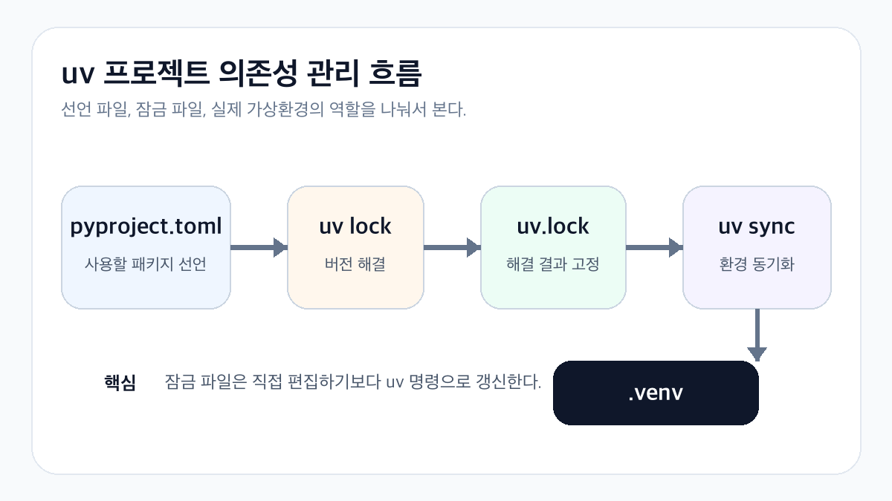

# 왜 uv 사용함?
> pip install로 패키지를 설치하는 방식은 단순하다. 다만 프로젝트가 커지면 어떤 의존성을 선언했고 실제 환경에는 무엇이 설치됐는지 따로 맞춰야 된다.
> uv는 프로젝트 정보, 가상환경, 잠금 파일을 한 흐름으로 관리할 수 있는 도구이다. 여러 환경에서 같은 의존성을 재현해야 한다면 파일 역할이 분명해진다는 장점이 있다.

# uv 프로젝트가 관리하는 파일
> 기본 프로젝트를 만들면 pyproject.toml을 중심으로 소스와 설정이 구성된다. 프로젝트 명령을 실행하면 .venv와 uv.lock도 함께 사용한다.
```markdown
im-uv/
├── .python-version
├── pyproject.toml
├── uv.lock
├── .venv/
└── src/
    └── im_uv/
```
> **pyproject.toml :** 프로젝트 정보와 직접 의존성 선언 
	**uv.lock : **해석된 의존성 버전을 잠금
	**.venv : **현재 컴퓨터에서 사용하는 실제 가상환경
- pyproject.toml은 무엇이 필요한지를 적고, uv.lock은 그 조건으로 해석된 결과를 고정한다. .venv는 두 파일을 바탕으로 현재 컴퓨터에 만들어지는 실행 환경이다.
# uv 커멘드
- 새 폴더를 만들 때는 uv init으로 시작한다.
```bash
$ uv init im-uv
$ cd im-uv
```
- 패키지는 uv add로 추가한다. ex) http 요청에 httpx를 사용시 다음과 같이 입력한다.
- uv add 시 해당 의존성은 pyproject.toml에도 기록된다.
```bash
$ uv add httpx
```
- 코드 실행 시에는 uv run으로 가능하다.
```bash
$ uv run python -c "import httpx; print(httpx.__version__)"
```
# venv와 pip 흐름 비교
기존 방식과 uv 방식은 목적이 완전히 다르기보다 관리 단위가 다르다.
<table header-row="true">
<colgroup>
<col width="239.66666666666666">
<col width="239.66666666666666">
<col width="239.66666666666666">
</colgroup>
<tr>
<td>**작업**</td>
<td>**venv와 pip**</td>
<td>**uv 프로젝트**</td>
</tr>
<tr>
<td>가상환경 생성</td>
<td>python -m venv .venv</td>
<td>프로젝트 명령에서 .venv 관리</td>
</tr>
<tr>
<td>의존성 추가</td>
<td>pip install 후 목록 별도 기록</td>
<td>uv add로 선언과 환경 반영</td>
</tr>
<tr>
<td>실행</td>
<td>환경 활성화 후 python</td>
<td>uv run</td>
</tr>
<tr>
<td>버전 고정</td>
<td>requirements나 별도 도구 사용</td>
<td>uv.lock</td>
</tr>
<tr>
<td>환경 맞추기</td>
<td>요구사항 파일 설치</td>
<td>uv sync</td>
</tr>
</table>
> 즉, 팀원이 같은 버전 조합을 받아야 하거나 CI에서 환경 차이를 줄이고 싶다면 잠금 파일을 함께 관리하는 편이 유리하다.
# uv sync와 uv.lock
- 저장소를 새로 받은 뒤에는 uv sync로 프로젝트 환경을 맞출 수 있다.
```bash
$ uv sync
```
- 만일 CI에서 잠금 파일이 현재 pyproject.toml과 일치하는지 확인하며 실행하고 싶은 경우 —locked를 사용하면 된다. 이렇게 할 시 잠금 파일을 임의로 갱신하지 않고, 설정과 맞지 않으면 실패하게 만드는 기준으로 사용할 수 있다. 의존성을 올리고 싶을시에는 개발 환경에서 명시적으로 잠금 파일을 갱신한 뒤 변경 내용을 함께 검토하는게 안전하다.
```bash
$ uv sync --locked
$ uv run pytest
```
